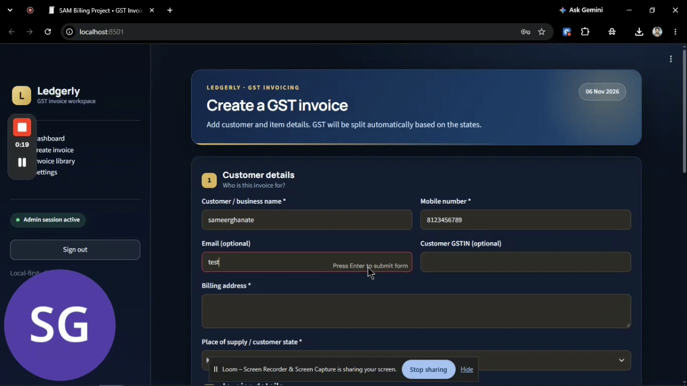
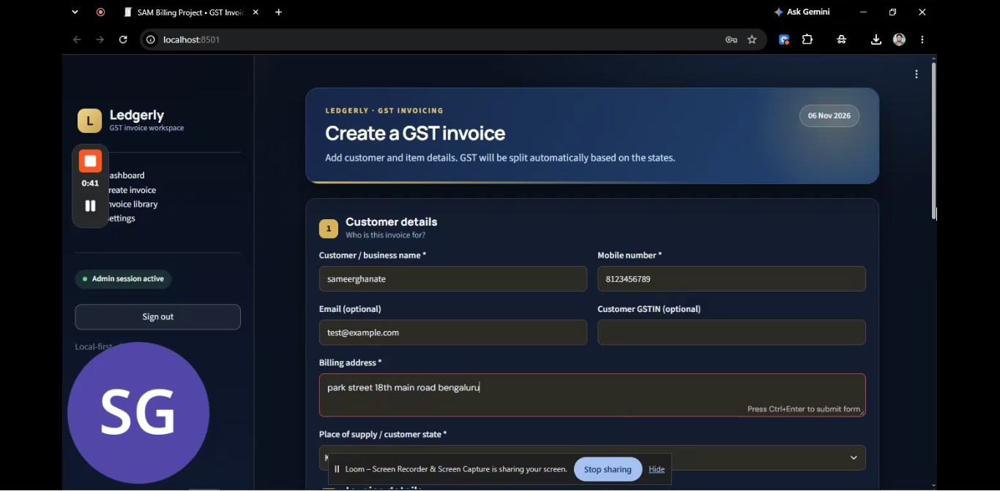
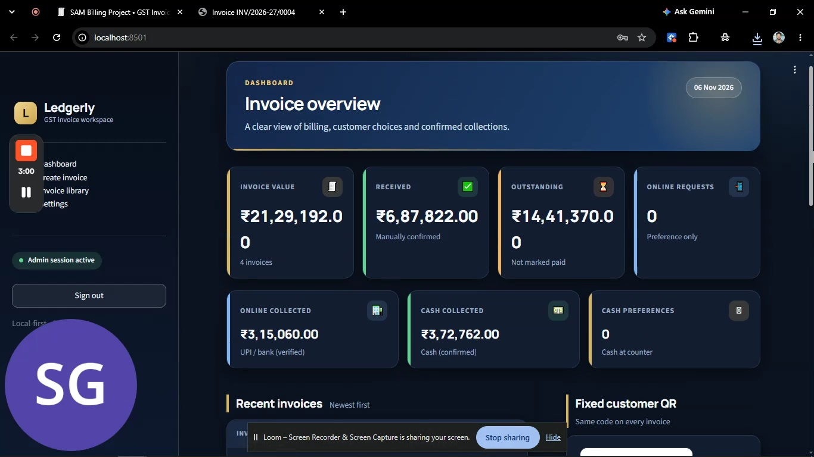
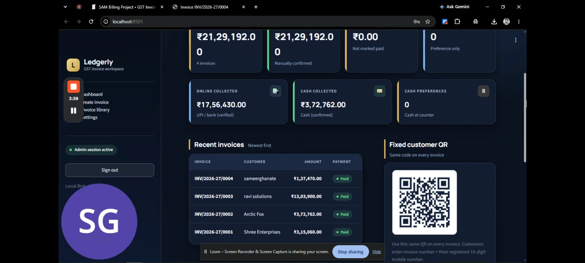
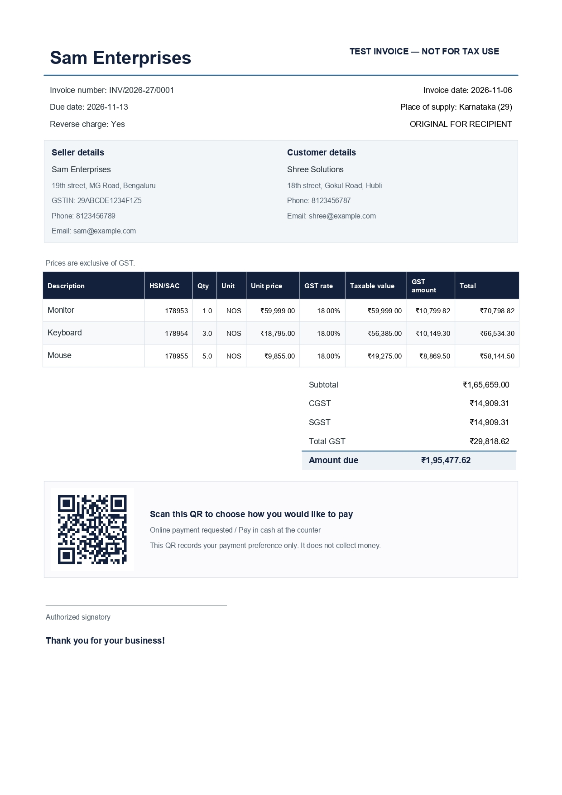

# Ledgerly — Indian GST Invoice Generator

A Python-first Streamlit application for creating GST invoices, generating downloadable PDFs, translating invoice labels and line-item descriptions, and recording customer payment preferences through one fixed QR code.

## Application Demo

Watch the application walkthrough to see the complete
GST invoicing workflow.


## Application Screenshots

### Creating invoice


### Showcasing Dashboard


### Validating Invoice Status


### Final Generated Invoice



## What it does

- Creates invoices with line items, HSN/SAC, quantities, unit prices and editable GST rates. Common post-22 September 2025 slabs include 0%, 5%, 18% and 40%; the editable rate field also accepts other notified/special rates when applicable.
- Applies CGST + SGST when supplier and customer are in the same state, and IGST when they are in different states.
- Generates invoice PDFs with the same customer-preference QR printed on every bill.
- Gives customers a public page to enter the invoice number and their registered 10-digit mobile number, then choose **online payment requested** or **cash at counter**.
- Shows customer choices in the admin dashboard.
- Keeps payment status separate from payment preference. Staff must manually verify receipt and mark an invoice paid.
- Tracks total invoice value, received money, outstanding balance, manually verified online/UPI/bank receipts, and cash receipts.
- Supports one-click translated PDFs using Google Cloud Translation API.
- Stores data in a local SQLite database at `data/invoices.db`.

## Important payment limitation

The QR does **not** accept money, open a UPI app, or verify a bank transaction. Choosing “I want to pay online” is only a request to staff. The dashboard will not count it as received money. After independently checking the payment in your bank/UPI app, staff can mark the invoice paid and select the payment method. The customer sees the thank-you message the next time they refresh or reopen the QR page; there is no SMS or push notification.

## Run in VS Code (Windows)

1. Install Python 3.10 or newer.
2. Open this folder in VS Code.
3. Open Terminal → New Terminal.
4. Run:

   ```powershell
   py -m venv .venv
   .venv\Scripts\Activate.ps1
   python -m pip install --upgrade pip
   pip install -r requirements.txt
   Copy-Item .env.example .env
   ```

5. Open `.env` and replace `ADMIN_PASSWORD` with a strong password.
6. Run:

   ```powershell
   streamlit run app.py
   ```

7. Open the local URL printed in the terminal, usually `http://localhost:8501`.

You can also double-click `run_windows.bat`; PowerShell execution policy may prevent activation through a script, in which case use the manual commands above.

## Make the fixed QR work on a phone

`localhost` refers to the device itself. A customer's phone cannot use your laptop's localhost address.

For testing on the same Wi-Fi:

1. Find your Windows IPv4 address with `ipconfig`.
2. Set `PUBLIC_APP_URL=http://YOUR-LAN-IP:8501` in `.env`, for example `http://192.168.1.25:8501`.
3. Start Streamlit using `streamlit run app.py --server.address 0.0.0.0`.
4. Allow Python/Streamlit through Windows Firewall on your private network.
5. Download the fixed QR from the dashboard and scan it with a phone connected to the same Wi-Fi.

For customers outside your Wi-Fi, deploy the app behind a public HTTPS address and set `PUBLIC_APP_URL` to that address. Do not expose a local business database to the public internet without proper hosting, backups, HTTPS, and security review.

## One-click translation

Translation is powered by Google Cloud Translation API. To enable it:

1. Create or select a Google Cloud project.
2. Enable Cloud Translation API and configure billing/API restrictions.
3. Create an API key restricted to the Translation API.
4. Put the key in `.env` as `GOOGLE_TRANSLATE_API_KEY=...`.
5. Restart Streamlit.

The app fetches the available target languages from Google when the API key works. Without a key, English PDF generation still works and a short fallback language list is displayed. Translation is machine-generated; check legal wording and tax descriptions before sending a translated invoice. Seller/customer names, addresses, identifiers and monetary amounts are intentionally not translated. Non-Latin PDF output also requires a compatible script font installed on the computer; Arabic right-to-left shaping and some CJK fonts may require additional setup.

## First-use workflow

1. Sign in with the password in `.env`.
2. Open **Settings** and save your business legal name, valid supplier GSTIN, address, state and contact details.
3. Open **Create invoice**, enter customer details, add line items and choose each applicable GST rate.
4. Download the PDF. The same fixed QR is embedded in every PDF.
5. Customer scans QR, enters invoice number + their registered 10-digit mobile number and chooses a payment preference.
6. Review the request in **Dashboard**.
7. Only after money is actually received and verified, select the invoice, choose the method and click **Confirm payment received**.

## GST and compliance caveats

- Current rate references: [GST Council/CBIC notifications](https://www.gstcouncil.gov.in/cgst-rate-notification) and [PIB summary of GST 2.0 changes](https://www.pib.gov.in/PressNoteDetails.aspx?ModuleId=3&NoteId=159075&lang=1&reg=3). Always verify the rate against the applicable HSN/SAC and notification.
- Invoice particulars: [CBIC Rule 46 tax invoice rules](https://cbic-gst.gov.in/gst-invoice-rules.html).

This is a starter invoicing tool, not tax or legal advice and not a substitute for GST-compliant accounting software. The seller chooses the GST rate and HSN/SAC; the app requires a valid-format supplier GSTIN to create a tax invoice. It does not verify the GSTIN against the GST portal. The app does not classify goods/services, validate HSN/SAC or verify legal tax treatment. It uses supplier state versus customer state to choose CGST/SGST or IGST, which is a simplified place-of-supply assumption. It does not calculate compensation cess, discounts, exports, e-commerce, special place-of-supply rules or other complex tax cases. The PDF includes a reverse-charge indicator and a manual signatory line, but is not digitally signed. Rule 46 includes supplier details/GSTIN, a consecutive financial-year serial number, issue date, recipient details, HSN/SAC, description, quantity and unit where applicable, taxable value, tax rates and amounts, place of supply where relevant, reverse-charge status and supplier signature/digital signature. This starter covers a subset and should not be treated as a compliant accounting product. Before issuing real tax invoices, have a GST practitioner verify the fields and tax treatment, invoice numbering, recipient state code, reverse-charge/export/e-commerce cases, credit notes, e-invoicing/e-way bill obligations and record-retention needs for your business.

Invoice numbers follow a simple local financial-year sequence and stay within the 16-character serial limit. For multi-user or regulated production use, harden numbering, permissions, audit logs, backups and hosting before going live.

## Tests

Run the core GST calculation tests with:

```powershell
python -m unittest discover -s tests -v
```

## Project Structure

gst-invoice-app/
├── assets/
│   ├── demo.gif
│   ├── dashboard.png
│   ├── create-invoice.png
│   └── invoice-preview.png
├── data/
│   └── .gitkeep
├── tests/
│   └── test_gst_core.py
├── .env.example
├── .gitignore
├── README.md
├── app.py
├── gst_core.py
├── requirements.txt
└── run_windows.bat
